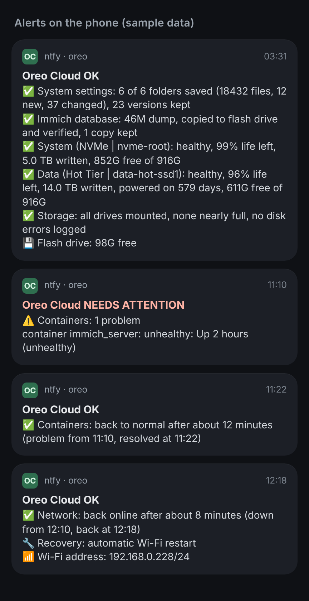
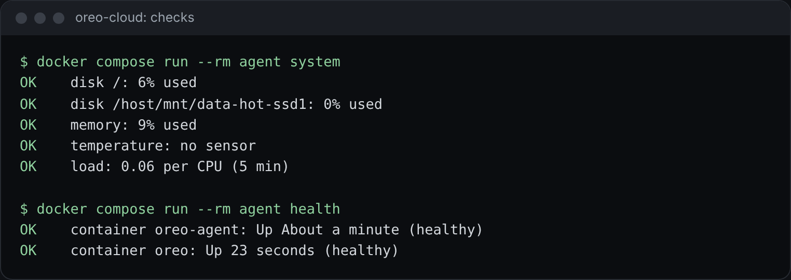

# oreo-cloud

[](LICENSE)

Everything that runs on **oreo-cloud**, my Raspberry Pi 5 home server: checks, alerts, the network watchdog, the nightly backup and container updates.

- It all ships as **one Docker image**, built by GitHub Actions and pulled on the Pi. Nothing of ours runs outside Docker.
- Alerts go to my phone through **ntfy**.
- **No secrets live here.** They stay in `.env` on the Pi.
- The outside check that the Pi is alive lives in the separate `oreo-monitor` repository.
- Every container is named `oreo-cloud-*` after its role, not after the software in it.
- [`mac/`](mac/) holds a temporary Mac stand-in of the photo app and its front door, for while
  the Pi is out for repair or replacement, under the same names.

## How it works

`compose.yaml` is the whole Pi, one compose project named `oreo-cloud`. Two containers run this repo's image:

| Container | What it does | Access |
| --- | --- | --- |
| `oreo-cloud-agent` | Runs every scheduled job (see below) and sends the alerts. | Root on the Pi, so it can repair Wi-Fi, read drive health and back up. No open port. |
| `oreo-cloud-metrics` | Answers the heartbeat that `oreo-monitor` checks over Tailscale. | Locked down: not root, read-only, listens only on the Tailscale address. |

The photo app (Immich) and its front door (Caddy) run beside them:

| Container (service) | What it is | Image |
| --- | --- | --- |
| `oreo-cloud-photos` (`photos`) | Immich server, on `127.0.0.1:2283` only | `immich-server`, tag `IMMICH_VERSION` |
| `oreo-cloud-photos-ml` (`photos-ml`) | Immich machine learning | `immich-machine-learning`, same tag |
| `oreo-cloud-db` (`db`) | Immich's Postgres, data in `DB_DATA_LOCATION` | pinned by digest |
| `oreo-cloud-cache` (`cache`) | Valkey | `ghcr.io/animesh-net/oreo-cloud-cache`, Immich's pinned Valkey with Debian security updates, built from [`cache/`](cache/) |
| `oreo-cloud-proxy` (`proxy`) | Caddy: `cloud.animesh.org.in`, `pi.animesh.org.in` and `ai.animesh.org.in`, HTTPS on the Tailscale address only | `ghcr.io/animesh-net/oreo-cloud-proxy`, built here from [`proxy/`](proxy/) |

Every image comes from GHCR, so the Pi never builds anything and pulls from one registry. The proxy's secrets (Cloudflare token, the password hash for `pi.`) live in `proxy.env` next to `.env`, so no other container sees them.

`ai.animesh.org.in` forwards to the oreo-ai web app, which runs on the Pi in its own compose project, `oreo-ai`, and publishes `127.0.0.1:8080`, with streamed replies passed on as they arrive. The app has its own sign-in, so there is no proxy password. It talks to Cloudflare Workers AI, or to Ollama on the MacBook Air over Tailscale; the Mac runs only Ollama now. The site is in the website checks, through the app's `/health`.

So the Pi runs another compose project beside this one: oreo-ai (containers `oreo-ai-web`, `oreo-ai-db` and the one-shot `oreo-ai-db-migrate`). The two are kept apart: separate folders (`~/oreo-cloud` and `~/oreo-ai`), separate compose files and settings, and neither touches the other's files. oreo-ai is set up and run from its own repository's image; `image-update` (below) updates it after oreo-cloud.

### What runs when

| Job | When | What happens |
| --- | --- | --- |
| Network watchdog | Every 2 minutes | Pings the router. After 2 misses it renews the Wi-Fi address; after 3 it restarts Wi-Fi, and again every 5th miss. Left alone 05:55 to 06:15, when the router restarts itself. |
| Clock | Every minute | Alerts if the clock is not synchronised. Container and system checks wait until it is. |
| Containers | Every 5 minutes | Every container running and healthy, oreo-ai's included. `oreo-ai-db-migrate` runs once and exits; it alerts only if it failed. |
| System | Every minute | Memory over 50%, CPU usage over 50% for more than 2 minutes, temperature over 50°C, any disk over 90% full. |
| Storage | Every 30 minutes | All four drives mounted, writable, under 90% full, no disk errors logged. |
| Websites | Every 30 minutes | `cloud.animesh.org.in`, `pi.animesh.org.in` and `ai.animesh.org.in` answer, and their certificates have at least 14 days left. |
| Backup age | Every 30 minutes | Alerts if the last good backup is more than 26 hours old. |
| Setup | Every 30 minutes | Alerts if the Pi's `compose.yaml` differs from the one in the image, with the command to refresh it. |
| Nightly backup | 03:30 | Saves the Pi's settings with restic and copies Immich's database dump to the flash drive, then sends the nightly report. The report also lists available OS, security and Docker updates, and a pending reboot; nothing is installed by itself. Runs later if the Pi was off at 03:30. |

### Alerts on my phone

| Title | Meaning |
| --- | --- |
| **Oreo Cloud NEEDS ATTENTION** | Something started failing. Sent once, again if what is failing changes, and as a reminder every hour until it is fixed. |
| **Oreo Cloud OK** | It is fixed, with how long it lasted. Also the title of a clean nightly report. |
| **Oreo Cloud FAILED** | A backup or update step failed; the message says why. |

While the network is down no alert can get out, so a Wi-Fi outage shows up as one "OK" message afterwards, saying what fixed it.

This is how they look, from top to bottom: a nightly report, a container problem and its fix, and a Wi-Fi outage that the watchdog repaired. The messages come from the real code, fed with sample data.



## Set up on the Pi

Every command is one line, so each can be pasted on its own from a phone.

1. Log in to the image registry with a **classic** GitHub token that has only `read:packages` (fine-grained tokens cannot read packages). Docker keeps the login, so this is needed once per token:

   ```bash
   echo "<token>" | docker login ghcr.io -u animesh-net --password-stdin
   ```

2. Get the two files the Pi needs from the image itself; git is not needed on the Pi:

   ```bash
   mkdir -p ~/oreo-cloud && cd ~/oreo-cloud
   docker run --rm ghcr.io/animesh-net/oreo-cloud show compose > compose.yaml
   docker run --rm ghcr.io/animesh-net/oreo-cloud show env-example > .env && chmod 600 .env
   ```

3. Fill in the required values in `.env` (the photo app's are listed in it too, and `proxy.env` is described at its end). These lines do it without showing the token on screen; the last one assumes the old alert file `/etc/oreo/alert.env`, otherwise set `OREO_NTFY_URL` with `nano .env`:

   ```bash
   sed -i "s|^DOCKER_GID=.*|DOCKER_GID=$(stat -c %g /var/run/docker.sock)|" .env
   sed -i "s|^OREO_BIND_IP=.*|OREO_BIND_IP=$(tailscale ip -4)|" .env
   sed -i "s|^OREO_HEARTBEAT_TOKEN=.*|OREO_HEARTBEAT_TOKEN=$(openssl rand -hex 32)|" .env
   sed -i "s|^OREO_NTFY_URL=.*|OREO_NTFY_URL=$(sudo grep -oP '^NTFY_URL=\K.*' /etc/oreo/alert.env | tr -d "\"'")|" .env
   ```

   To copy a value to the phone, for example the heartbeat token for `oreo-monitor`, send it to yourself and delete the message afterwards: `docker compose run --rm agent notify "$(grep ^OREO_HEARTBEAT_TOKEN= .env | cut -d= -f2)"`.

4. Start it:

   ```bash
   docker compose pull && docker compose up -d
   ```

5. Check it. Every container should say `healthy` within a minute, and the two commands should match the last nightly report.

   ```bash
   docker ps
   docker compose run --rm agent storage
   docker compose run --rm agent drives
   ```

6. Run one backup by hand. The first one takes longer.

   ```bash
   docker compose run --rm agent backup
   ```

7. Turn off the old host timers. Until you do, the agent leaves the network repairs and the backup to them and sends one alert reminding you.

   ```bash
   sudo systemctl disable --now oreo-osbackup.timer oreo-netwatch.timer
   ```

8. After a week of clean nightly reports, delete the old scripts from `/usr/local/bin` and their timer and service files.

## Everyday use

Run any command with `docker compose run --rm agent <command>`:




| Command | What it does |
| --- | --- |
| `system`, `health`, `storage`, `sites` | Run that check now and print the result. Add `--notify` to send alerts too. |
| `drives` | Drive health: status, life left, data written, free space. |
| `backup` | Run the nightly backup now. |
| `update status` | Containers, free space, whether the Pi needs a reboot, and which updates are available. |
| `update immich` | Update the photo app (`photos`, `photos-ml`). Takes a database dump first and stops if the dump looks wrong. |
| `update caddy` | Pull the latest proxy and cache images and restart `proxy` and `cache`. |
| `update prune` | Remove unused Docker images. |
| `update all` | Immich, then the proxy and cache, then prune. |
| `update os` | Upgrade Ubuntu's packages (`apt-get update`, `upgrade`, `autoremove`), keeping changed config files. Runs as the host service `oreo-os-update`, so an upgrade that restarts Docker does not cut it off; its log is `journalctl -u oreo-os-update`. Never reboots. |
| `notify "message"` | Send a test notification. |

Nothing is updated automatically. The nightly report and `update status` say what is available, each with the command that installs it, and each update is started by hand. Never run a plain `docker compose pull` here: it would pull a new Immich and `up -d` would start it without the database dump `update immich` takes first. Pull only this repo's image, `docker compose pull heartbeat agent`. To update everything except the OS in one line (it also writes the new image's `compose.yaml`, so a changed one never needs a separate step), then oreo-ai in its own folder, `~/oreo-ai`, from its image:

```bash
cd ~/oreo-cloud && docker compose pull heartbeat agent && docker run --rm ghcr.io/animesh-net/oreo-cloud show compose > compose.yaml && docker compose up -d && docker compose run --rm agent update all && docker compose run --rm agent update status && docker run --rm --pull always ghcr.io/animesh-net/oreo-ai | tar -xf - -C ~/oreo-ai && bash ~/oreo-ai/scripts/oreo-ai.sh on
```

The oreo-ai part needs its folder, created once with `mkdir -p ~/oreo-ai`; oreo-ai's own README covers its first start and its `.env.local`.

Run `update os` on its own, away from the 03:30 backup and the router restart at 06:00, then `sudo reboot` if `update status` says a reboot is needed. Ubuntu installs security updates by itself unless that is turned off on the Pi: `/etc/apt/apt.conf.d/20auto-upgrades` with `APT::Periodic::Unattended-Upgrade "0";` stops it, and `APT::Periodic::Update-Package-Lists "1";` keeps the daily package list refresh the report reads.

Two short names do the same: `os-update` for the OS and `image-update` for the line above, which updates oreo-cloud and then oreo-ai. This sets both up once on the Pi, replacing any older definitions of them:

```bash
sed -i '/^alias os-update=/d;/^alias image-update=/d' ~/.bashrc ~/.bash_aliases 2>/dev/null; printf '%s\n' "alias os-update='docker compose -f ~/oreo-cloud/compose.yaml run --rm agent update os'" "alias image-update='(cd ~/oreo-cloud && docker compose pull heartbeat agent && docker run --rm ghcr.io/animesh-net/oreo-cloud show compose > compose.yaml && docker compose up -d && docker compose run --rm agent update all && docker compose run --rm agent update status) && docker run --rm --pull always ghcr.io/animesh-net/oreo-ai | tar -xf - -C ~/oreo-ai && bash ~/oreo-ai/scripts/oreo-ai.sh on'" >> ~/.bashrc && source ~/.bashrc
```

In PowerShell (`pwsh`) on the Pi, the same short names go in the profile; this replaces it with them:

```powershell
New-Item -ItemType Directory -Force (Split-Path $PROFILE) | Out-Null; Set-Content $PROFILE -Value @('function la { /usr/bin/ls -A @args }', 'function os-update { docker compose -f "$HOME/oreo-cloud/compose.yaml" run --rm agent update os }', 'function image-update { Push-Location "$HOME/oreo-cloud"; try { docker compose pull heartbeat agent && docker run --rm ghcr.io/animesh-net/oreo-cloud show compose | Set-Content compose.yaml && docker compose up -d && docker compose run --rm agent update all && docker compose run --rm agent update status } finally { Pop-Location }; if ($LASTEXITCODE -eq 0) { bash -c ''docker run --rm --pull always ghcr.io/animesh-net/oreo-ai | tar -xf - -C ~/oreo-ai''; if ($LASTEXITCODE -eq 0) { bash "$HOME/oreo-ai/scripts/oreo-ai.sh" on } } }'); . $PROFILE
```

### Update or roll back this image

Code, settings and `compose.yaml` all come with the image, so this is the whole update (`image-update` includes it):

```bash
cd ~/oreo-cloud && docker compose pull heartbeat agent && docker run --rm ghcr.io/animesh-net/oreo-cloud show compose > compose.yaml && docker compose up -d
```

If the Pi's `compose.yaml` ever differs from the image's, for example after a pull without `image-update`, the agent sends a **Setup** alert; `image-update` clears it.

The last 10 images are kept. To roll back, add `OREO_IMAGE_TAG=sha-<commit>` to `.env` and run `docker compose up -d`. Remove that line to go back to the latest. The tag applies to the proxy and cache images too, which are built from the same commit.

### Moving from ~/immich and ~/caddy (one time)

Before this, Immich and Caddy ran as their own compose projects in `~/immich` and `~/caddy`, with containers named `immich_*` and `caddy-caddy-1`. `pi/migrate.sh` moves them into this project. It ships in the image. Run from `~/oreo-cloud`, one line at a time:

```bash
docker compose pull heartbeat agent
docker run --rm ghcr.io/animesh-net/oreo-cloud show migrate > migrate.sh
bash migrate.sh --dry-run
bash migrate.sh
```

It reads the settings from `~/immich/.env` and `~/caddy` (nothing is retyped), dumps the database first, removes the old containers (photos, database and the old folders stay), writes the image's `compose.yaml`, copies the proxy's certificates and the ML model cache into the new volumes, starts everything and checks the asset count and `https://cloud.animesh.org.in`. If a check fails it puts the old projects back. It also changes the `image-update` alias to pull only this repo's image. The site is down for about a minute; run it away from the 03:30 backup.

## If something goes wrong

| Problem | What to do |
| --- | --- |
| A check alerts | The alert names the failing check. Run that check by hand to see the detail, for example `docker compose run --rm agent storage`. |
| `oreo-cloud-agent` is unhealthy or missing | `docker compose logs agent`, then `docker compose up -d`. |
| Docker itself is down | Nothing inside Docker can fix this. Connect over Tailscale with SSH, then run `sudo systemctl restart docker` and `docker compose up -d`. |
| A backup failed | The alert says which step failed. Fix that, then run `docker compose run --rm agent backup`. |
| An old stopped container keeps alerting | Remove it, or give it the label `oreo.ignore=true`. |
| `docker compose up` says `/mnt` "is not a shared or slave mount" | Run `sudo mount --make-rshared /`. Ubuntu with systemd already does this at boot, so it only happens on unusual setups. |

## Settings

Required, in `.env`:

| Setting | What it is |
| --- | --- |
| `DOCKER_GID` | Group of the Docker socket: `stat -c %g /var/run/docker.sock` |
| `OREO_HEARTBEAT_TOKEN` | Password for the heartbeat, shared with `oreo-monitor`: `openssl rand -hex 32` |
| `OREO_NTFY_URL` | The ntfy topic alerts go to |
| `OREO_BIND_IP` | The Pi's Tailscale address: `tailscale ip -4` |

Everything else is optional and listed, with its default, at the bottom of `.env.example`. Uncomment a line to change it. The most useful ones:

| Setting | Default | What it changes |
| --- | --- | --- |
| `OREO_BACKUP_TIME` | `03:30` | Time of the nightly backup |
| `OREO_NET_QUIET_WINDOW` | `05:55-06:15` | When the router restarts itself |
| `OREO_SITES` | the three sites | Websites the agent checks |
| `OREO_IMAGE_TAG` | `latest` | Image to run; set a `sha-` tag to roll back |

Drive paths, alert thresholds and the reminder interval live in [`config/settings.env`](config/settings.env), which is built into the image. A change goes through a pull request like any other, and the next `docker compose pull heartbeat agent && docker compose up -d` applies it. A value set in the Pi's `.env` overrides the built-in one.

| Setting | Value | Alerts when |
| --- | --- | --- |
| `OREO_MEMORY_MAX_PERCENT` | `50` | More than half the RAM is in use (cache does not count) |
| `OREO_CPU_MAX_PERCENT`, `OREO_CPU_SUSTAINED_SECONDS` | `50`, `120` | CPU usage stays over 50% for more than 2 minutes |
| `OREO_TEMPERATURE_MAX_C` | `50` | The CPU is hotter than 50°C |
| `OREO_DISK_MAX_PERCENT` | `90` | Any checked disk is more than 90% full |
| `OREO_ALERT_REMINDER_HOURS` | `1` | How often a problem is repeated while it lasts |

When the HDDs are mounted, add them to `OREO_DISK_PATHS` and `OREO_MOUNT_PATHS` in `config/settings.env`, and set `OREO_STORAGE_MOUNTS` and `OREO_DRIVES` there too.

## Development

```bash
python3 -m venv .venv && . .venv/bin/activate
pip install -e ".[dev]"
pre-commit install
pytest
```

- Pre-commit hooks lint and format the code, check each commit message (one line, capitalised, at most 72 characters, no extra trailers), block commits to `main` and run the tests before a push.
- Every push to `main` builds the `linux/arm64` image, runs the integration tests in `tests/integration/` against it, scans it for critical vulnerabilities and publishes it to `ghcr.io/animesh-net/oreo-cloud`. Pull requests build and test it without publishing.
- The integration tests need Docker: `docker build -t oreo-cloud:test . && OREO_IMAGE=oreo-cloud:test pytest tests/integration`.
- To merge a Dependabot pull request, approve it and leave the merge button alone: the `Dependabot merge` workflow waits for the checks and squash-merges it with just its title, without the `Co-authored-by` and `Signed-off-by` lines GitHub's button would add.
- Dependabot's commits are checked by title only: their bodies hold a changelog, and a squash merge keeps only the title.
- Dependabot opens weekly pull requests for the pinned Actions, the base image, the cache's Valkey pin and Python packages.

## Changes

Every change goes through a pull request against `main` and is squash-merged by me. The rules are in `CLAUDE.md`. GitHub does not enforce branch rules on this private repository, so the pre-commit hooks and CI are the guard.

## License

Copyright © 2026 Animesh Singh. Released under the [MIT License](LICENSE).
